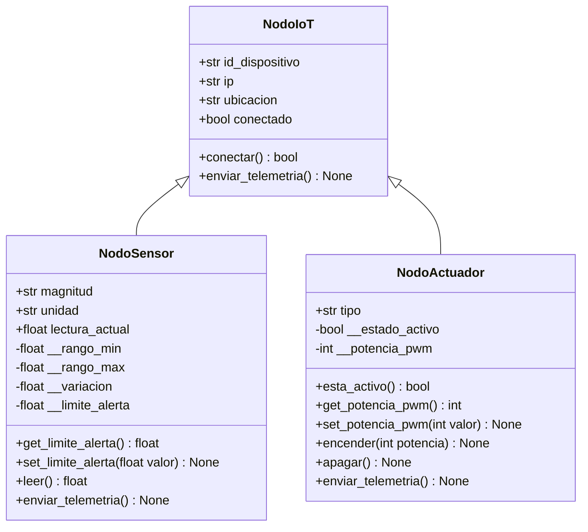

# Universidad Veracruzana
## **Reporte de Práctica de Laboratorio — Programación Orientada a Objetos**
### **EE: Temas Selectos de IIE II (Código: IEDI 18005)**
#### **Facultad de Instrumentación Electrónica — Universidad Veracruzana**

---

### **Información General del Equipo**

*   **Número de Práctica:** Práctica 2
*   **Título de la Práctica:** Sistema Modular de Nodos IoT (Herencia y Polimorfismo en Python)
*   **Fecha de Entrega:** 07/11/2026
*   **Enlace al Repositorio de GitHub:** https://github.com/DarkZodiac0/mirepositorio_poo/tree/main/Practica-02

| Nombre Completo del Integrante | Matrícula UV | Usuario de GitHub |
| :--- | :--- | :--- |
| Axel Arturo Pérez Montero | S23013994 | @DarkZodiac0 |
| Bremont Limon Isaac Gabriel | S23013923 | @Isaaclimon14 |

---

### **Sección 1: Mapeo de Abstracción (Hardware ➔ POO)**

En esta práctica la red de nodos IoT se simula en Python. Cada dispositivo que existiría en una instalación real (un sensor de temperatura, un sensor de luz y un ventilador) se modela como un objeto lógico que hereda de una clase padre común, `NodoIoT`. Los atributos reflejan las características del dispositivo físico (identificador, dirección de red, rango de medición, potencia) y los métodos reflejan lo que ese dispositivo puede hacer (conectarse, medir, encender, reportar su estado).

| Objeto | Clase | Dispositivo simulado | ID | IP | Ubicación |
| :--- | :--- | :--- | :--- | :--- | :--- |
| `sensor_temp` | `NodoSensor` | Sensor de temperatura (-40 a 125 °C) | TEMP-01 | 192.168.1.10 | Sala de servidores |
| `actuador_ventilador` | `NodoActuador` | Ventilador con control PWM | VENT-01 | 192.168.1.20 | Sala de servidores |
| `sensor_luz` | `NodoSensor` | Sensor de luminosidad (0 a 100000 lx) | LUZ-01 | 192.168.1.11 | Sala de servidores |

#### **1.1. Diagrama de Clases UML**

*Figura 1. Diagrama de clases. Visibilidades: `+` público y `-` privado. Las flechas con triángulo hueco indican herencia: `NodoSensor` y `NodoActuador` derivan de la clase padre `NodoIoT`. Ambas sobrescriben `enviar_telemetria()`.*

#### **1.2. Mapeo de Atributos (Características Físicas ➔ Variables de Clase)**

*   **Clase `NodoIoT`**:
    *   `id_dispositivo`: identificador único del nodo (por ejemplo, TEMP-01); equivale a la etiqueta que distinguiría un módulo físico de otro.
    *   `ip`: dirección de red del nodo, la que tendría un microcontrolador real conectado a la red.
    *   `ubicacion`: lugar físico donde estaría instalado el dispositivo.
    *   `conectado`: estado del enlace del nodo con la red (verdadero tras llamar a `conectar()`).
*   **Clase `NodoSensor`**:
    *   `magnitud` y `unidad`: variable física que mide el sensor y su unidad (temperatura en °C, luminosidad en lx).
    *   `lectura_actual`: último valor entregado por el transductor, equivalente a la lectura convertida por el ADC.
    *   `__rango_min` y `__rango_max` (privados): límites físicos de medición del sensor según su hoja de datos; se usan para validar valores y evitar lecturas imposibles.
    *   `__variacion` (privado): cambio máximo entre una lectura y la siguiente; simula el ruido y la inercia de la magnitud real.
    *   `__limite_alerta` (privado): umbral a partir del cual el sensor reporta una alerta; solo se modifica mediante su setter validado.
*   **Clase `NodoActuador`**:
    *   `tipo`: clase de dispositivo que acciona (por ejemplo, Ventilador).
    *   `__estado_activo` (privado): indica si el relé o motor está energizado o apagado.
    *   `__potencia_pwm` (privado): ciclo de trabajo aplicado al actuador, de 0 a 100 %; vale 0 cuando está apagado.

#### **1.3. Mapeo de Métodos (Acciones del Hardware ➔ Funciones miembro)**

*   **Clase `NodoIoT`**:
    *   `conectar()`: simula el enlace del dispositivo a la red, pone `conectado` en verdadero y lo informa por consola.
    *   `enviar_telemetria()`: reporta la información del nodo; la versión del padre es genérica y cada subclase la sobrescribe.
*   **Clase `NodoSensor`**:
    *   `leer()`: simula la adquisición de una nueva lectura con una variación aleatoria acotada al rango físico del sensor.
    *   `get_limite_alerta()` y `set_limite_alerta(valor)`: acceso controlado al umbral; el setter rechaza valores no numéricos o fuera del rango físico.
    *   `enviar_telemetria()`: toma una lectura y muestra magnitud, valor, unidad y límite, con una alerta si lo supera.
*   **Clase `NodoActuador`**:
    *   `encender(potencia)` y `apagar()`: cambian el estado del actuador; al encender se aplica la potencia PWM pedida y al apagar se pone en 0.
    *   `set_potencia_pwm(valor)`: ajusta la potencia solo si el valor está entre 0 y 100 y el actuador está encendido.
    *   `esta_activo()` y `get_potencia_pwm()`: consultan el estado interno sin exponer los atributos privados.
    *   `enviar_telemetria()`: muestra si el actuador está encendido o apagado y su potencia PWM.

---

### **Sección 2: El Registro de Errores ("Bug Log")**

| # | Falla Física o Lógica Detectada | Causa Raíz (Hardware / Software) | Solución Técnica Implementada en Código / Conexión |
| :--- | :--- | :--- | :--- |
| **1** | Al ejecutar `python3 main.py`, el programa terminaba con `ModuleNotFoundError: No module named 'nodo_iot'` (Figura 2). | El archivo de la clase padre estaba guardado como `nodos_IOT.py`, pero `nodos_hijos.py` lo importa como `nodo_iot`. El nombre difería en una letra y en mayúsculas, y en Linux los nombres de archivo distinguen mayúsculas de minúsculas, por lo que Python no encontraba el módulo. | Se renombró el archivo a `nodo_iot.py`, igual que el módulo importado y que la estructura del repositorio (`Practica-02/src/`), y el programa se ejecutó sin errores. |
| **2** | [Describir falla real de laboratorio] | [Describir causa analizada] | [Explicar solución técnica implementada] |

*Figura 2. Error mostrado en la terminal antes de renombrar el archivo.*

---

### **Sección 3: Justificación del Diseño Orientado a Objetos**

1.  **Herencia y Reutilización de Código:**
    *   *Respuesta:* Sí se utilizó herencia. La **superclase** es `NodoIoT` y las **subclases** son `NodoSensor` y `NodoActuador`. El padre concentra lo que todos los dispositivos comparten (`id_dispositivo`, `ip`, `ubicacion`, `conectado` y el método `conectar()`), y cada hija reutiliza ese constructor con `super().__init__()` en lugar de repetirlo. Además, una misma clase sirve para varios dispositivos: los dos sensores de la red (`sensor_temp` y `sensor_luz`) son instancias de `NodoSensor` con distintos parámetros.

2.  **Polimorfismo:**
    *   *Respuesta:* El método `enviar_telemetria()` se define en `NodoIoT` y se sobrescribe en cada subclase: el sensor toma una lectura y muestra su valor, unidad y límite (con alerta si lo supera), mientras que el actuador muestra si está encendido o apagado y su potencia PWM. El script principal guarda los tres dispositivos en una lista mixta (`red_iot`) y la recorre con un solo `for` que llama a `dispositivo.enviar_telemetria()`, sin ningún `if/else` para identificar el tipo de objeto: cada uno responde según su clase.

3.  **Encapsulamiento y Ocultamiento de Datos:**
    *   *Respuesta:* Son **privados** (con doble guion bajo) `__limite_alerta`, `__rango_min`, `__rango_max` y `__variacion` en el sensor, y `__estado_activo` y `__potencia_pwm` en el actuador. Para acceder a ellos de forma segura se usan getters y setters: `set_limite_alerta()` solo acepta números dentro del rango físico del sensor (si no, lanza `TypeError` o `ValueError`); `set_potencia_pwm()` exige un valor de 0 a 100 y que el actuador esté encendido; y el estado solo cambia mediante `encender()` y `apagar()`. Así ningún código externo puede dejar a un dispositivo en un estado imposible, como un límite de 500 °C o una potencia del 150 %.

---

### **Sección 4: Evidencias de Funcionamiento (Validación Dual)**

#### **4.1. Captura de Pantalla de la Terminal / Monitor Serial**

#### **4.2. Enlace Directo al Video Demostrativo (Máximo 1.5 minutos)**

*   **Enlace de Visualización:** https://uvmx-my.sharepoint.com/:f:/g/personal/zs23013994_estudiantes_uv_mx/IgARxvWLRNf_R5IK0iprsiHkAaTqw67CGSnb-sycdt95rFA?e=Fi0oMk
