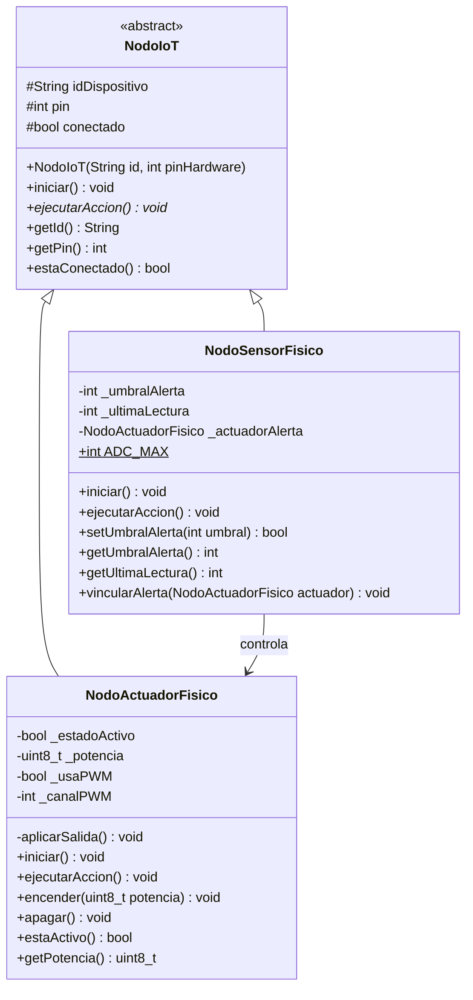

# Universidad Veracruzana
## **Reporte de Práctica de Laboratorio — Programación Orientada a Objetos**
### **EE: Temas Selectos de IIE II (Código: IEDI 18005)**
#### **Facultad de Instrumentación Electrónica — Universidad Veracruzana**

---

### **Información General del Equipo**

*   **Número de Práctica:** Práctica 3
*   **Título de la Práctica:** Implementación Física de Nodos IoT Heterogéneos en C++ (ESP32)
*   **Fecha de Entrega:** [DD/MM/AAAA]
*   **Enlace al Repositorio de GitHub:** https://github.com/DarkZodiac0/mirepositorio_poo/tree/main/Practica-03

| Nombre Completo del Integrante | Matrícula UV | Usuario de GitHub |
| :--- | :--- | :--- |
| Axel Arturo Pérez Montero | S23013994 | @DarkZodiac0 |
| Bremont Limon Isaac Gabriel | S23013923 | @Isaaclimon14 |

---

### **Sección 1: Mapeo de Abstracción (Hardware ➔ POO)**

En esta práctica la jerarquía de clases de la Práctica 2 se traslada a hardware real: un microcontrolador ESP32 programado en C++ que lee un sensor de luz (LDR) y controla un LED. Cada componente físico se modela como un objeto que hereda de la clase base `NodoIoT`: el LDR como un `NodoSensorFisico` y el LED como un `NodoActuadorFisico`. Los atributos representan las propiedades eléctricas y de conexión del componente (pin, rango del ADC, estado y potencia de la salida) y los métodos representan lo que se hace con él (iniciarlo, leerlo, encenderlo).

| Objeto | Clase | Componente físico | ID | Pin del ESP32 | Interfaz |
| :--- | :--- | :--- | :--- | :--- | :--- |
| `sensor` | `NodoSensorFisico` | LDR con divisor de voltaje (resistencia de 10 kΩ) | SENS_LUZ | GPIO 34 | Entrada analógica (ADC de 12 bits) |
| `actuador` | `NodoActuadorFisico` | LED con resistencia de 220 Ω | ACT_LED | GPIO 25 | Salida PWM (5 kHz, 8 bits) |

Ambos objetos se guardan en el arreglo `NodoIoT* red[N]` y el programa los gestiona mediante punteros a la clase base.

#### **1.1. Diagrama de Clases UML**

*Figura 1. Diagrama de clases. Visibilidades: `+` público, `#` protegido y `-` privado. Las flechas con triángulo hueco indican herencia hacia `NodoIoT`, y la flecha simple indica que el sensor controla al actuador mediante un puntero.*

#### **1.2. Mapeo de Atributos (Características Físicas ➔ Variables de Clase)**

*   **Clase `NodoIoT`**:
    *   `idDispositivo` (protegido): nombre que identifica al componente dentro del sistema (por ejemplo, SENS_LUZ).
    *   `pin` (protegido): número de GPIO del ESP32 al que está conectado físicamente el componente.
    *   `conectado` (protegido): indica que el nodo ya fue inicializado, es decir, que su pin está configurado y listo.
*   **Clase `NodoSensorFisico`**:
    *   `_umbralAlerta` (privado): valor del ADC, entre 0 y 4095, a partir del cual se considera que hay alerta; equivale a un nivel de luz determinado.
    *   `_ultimaLectura` (privado): último valor crudo entregado por el ADC de 12 bits del ESP32, que convierte de 0 V a 3.3 V en 0 a 4095 cuentas.
    *   `ADC_MAX`: límite físico del ADC del ESP32 (4095), usado para validar el umbral.
    *   `_actuadorAlerta` (privado): referencia al actuador físico que responde cuando hay alerta.
*   **Clase `NodoActuadorFisico`**:
    *   `_estadoActivo` (privado): estado lógico de la salida, encendida o apagada.
    *   `_potencia` (privado): ciclo de trabajo de la señal PWM, de 0 a 255, que determina el brillo del LED.
    *   `_usaPWM` y `_canalPWM` (privados): indican si la salida es PWM o digital y qué canal del periférico LEDC del ESP32 la genera.

#### **1.3. Mapeo de Métodos (Acciones del Hardware ➔ Funciones miembro)**

*   **Clase `NodoIoT`**:
    *   `iniciar()`: marca el nodo como conectado e informa por el puerto serie; cada subclase lo extiende para configurar su propio pin.
    *   `ejecutarAccion()` (virtual puro): define la acción principal del nodo; cada subclase lo implementa según su hardware.
*   **Clase `NodoSensorFisico`**:
    *   `iniciar()`: configura el pin como entrada con `pinMode(pin, INPUT)`.
    *   `ejecutarAccion()`: lee el voltaje del divisor con `analogRead()`, lo compara con el umbral, reporta el valor por el monitor serie y ordena al actuador encender o apagar.
    *   `setUmbralAlerta(umbral)`: asigna el umbral solo si está dentro del rango del ADC (0 a 4095); en caso contrario lo rechaza y devuelve `false`.
*   **Clase `NodoActuadorFisico`**:
    *   `iniciar()`: configura el pin como salida con `pinMode(pin, OUTPUT)` y, si usa PWM, asocia el pin a un canal del periférico LEDC.
    *   `encender(potencia)` y `apagar()`: cambian el estado lógico del actuador.
    *   `ejecutarAccion()`: aplica el estado al pin con `ledcWrite()` (PWM) o `digitalWrite()` y reporta el estado por el monitor serie.

#### **1.4. Diagrama Esquemático de Conexiones**

*Figura 2. Esquemático del circuito, realizado en KiCad.*

| Componente | Conexión |
| :--- | :--- |
| LDR (`R_Photo`) | Entre +3.3V y la red `Nodo_LDR` |
| Resistencia de 10 kΩ | Entre la red `Nodo_LDR` y GND |
| ESP32, GPIO 34 (ADC) | A la red `Nodo_LDR` (punto medio del divisor) |
| ESP32, GPIO 25 | Red `LED_SALIDA`, a una resistencia de 220 Ω |
| LED | Ánodo a la resistencia de 220 Ω y cátodo a GND |
| ESP32, VDD y GND | A +3.3V y GND |

---

### **Sección 2: El Registro de Errores ("Bug Log")**

| # | Falla Física o Lógica Detectada | Causa Raíz (Hardware / Software) | Solución Técnica Implementada en Código / Conexión |
| :--- | :--- | :--- | :--- |
| **1** | [Describir falla real de laboratorio] | [Describir causa analizada] | [Explicar solución técnica implementada] |
| **2** | [Describir falla real de laboratorio] | [Describir causa analizada] | [Explicar solución técnica implementada] |

---

### **Sección 3: Justificación del Diseño Orientado a Objetos**

1.  **Herencia y Reutilización de Código:**
    *   *Respuesta:* Sí se utilizó herencia. La **superclase** es `NodoIoT` (abstracta) y las **subclases** son `NodoSensorFisico` y `NodoActuadorFisico`. El padre concentra lo que comparten todos los componentes (`idDispositivo`, `pin`, `conectado` y los métodos `iniciar()`, `getId()`, `getPin()` y `estaConectado()`), y cada hija reutiliza el constructor del padre mediante su lista de inicialización (por ejemplo, `: NodoIoT(id, pinSalida)`). Sus métodos `iniciar()` también llaman a `NodoIoT::iniciar()` para no repetir esa parte.

2.  **Polimorfismo:**
    *   *Respuesta:* `ejecutarAccion()` es un método virtual puro en `NodoIoT` y cada subclase lo sobrescribe: el sensor lee el ADC con `analogRead()` y reporta el valor, mientras que el actuador conmuta la salida con `ledcWrite()` o `digitalWrite()`. El programa guarda ambos objetos en el arreglo `NodoIoT* red[N]` y el `loop()` los recorre con `red[i]->ejecutarAccion()` sin preguntar el tipo de cada uno; el destructor virtual de la base permite liberar los objetos correctamente a través de esos punteros. De la misma forma, `setup()` llama a `red[i]->iniciar()`.

3.  **Encapsulamiento y Ocultamiento de Datos:**
    *   *Respuesta:* Son **privados** `_umbralAlerta`, `_ultimaLectura` y `_actuadorAlerta` en el sensor, y `_estadoActivo`, `_potencia`, `_usaPWM` y `_canalPWM` en el actuador, además del método `aplicarSalida()`. Son **protegidos** `idDispositivo`, `pin` y `conectado`, que solo deben ver las clases hijas. El acceso es mediante métodos públicos: `setUmbralAlerta()` valida que el valor esté entre 0 y 4095, el rango del ADC del ESP32, y rechaza cualquier otro; los getters son `const`; y el actuador solo cambia de estado con `encender()` y `apagar()`. Así el programa principal no puede escribir directamente en un pin ni dejar al hardware en un estado inválido.

---

### **Sección 4: Evidencias de Funcionamiento (Validación Dual)**

#### **4.1. Captura de Pantalla de la Terminal / Monitor Serial**

> **[INSERTA AQUÍ LA CAPTURA DEL MONITOR SERIE A 115200 BAUDIOS]**

#### **4.2. Fotografía del Circuito Físico Armado (Garantía de Autoría)**

> **[INSERTA AQUÍ LA FOTOGRAFÍA DEL CIRCUITO ARMADO EN PROTOBOARD CON SU NOTA ESCRITA A MANO (fecha, número de práctica y matrículas)]**

#### **4.3. Enlace Directo al Video Demostrativo (Máximo 3 minutos)**

https://uvmx-my.sharepoint.com/:f:/g/personal/zs23013994_estudiantes_uv_mx/IgBPMp9h5loKQqKnyFafiSxGAS099DY-LjMGhDIyH3jaGlc?e=OKUTBN
